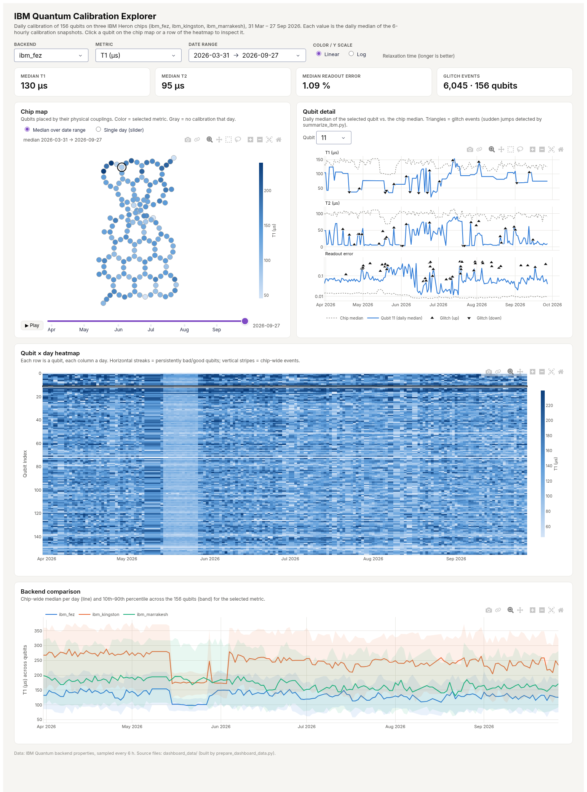

# IBM Quantum Hardware: Calibration Data Analysis

Final project analysing historical calibration data of three IBM quantum computers
(**ibm_fez**, **ibm_kingston**, **ibm_marrakesh**) and what it means for the reliability of the hardware.

## Research questions

1. How stable are T1 and T2 over 30, 60, 90, and 180 days?
2. Are high-error qubits clustered together physically on the chip, or distributed uniformly?
3. How often does a qubit experience sudden "glitches" (dramatic spikes in error rates) between calibration snapshots?

## Repository content

| File | Purpose |
|---|---|
| `get_ibm.py` | Downloads the calibration history from IBM Quantum and saves it as `ibm_calibration_history.csv`. Needs an IBM Quantum account. |
| `summarize_ibm.py` | Checks data quality, cleans the data, and prints/saves the summary statistics for the three research questions. Can also download the qubit connections (`--fetch-coupling`). |
| `plot_ibm.py` | Draws the figures: chip maps, feature distributions, qubit-by-time heatmaps, correlation matrices. |
| `coupling_map.csv` | Qubit connections (`backend,q1,q2`) of the three chips. |
| `ibm_calibration_history.csv` | Raw dataset (about 44 MB), so you can run the analysis without an IBM account. |
| `figures/` | PNG figures produced by `plot_ibm.py` (chip maps, distributions, heatmaps, correlations). |
| `dashboard.py` | Interactive Plotly Dash dashboard for exploring the data (see [Dashboard](#dashboard)). |
| `prepare_dashboard_data.py` | Builds the small data files in `dashboard_data/` that the dashboard reads. |
| `dashboard_data/` | Pre-computed dashboard data (about 1.8 MB): daily medians per qubit, glitch events, chip layout. |
| `requirements.txt` | Python packages needed. |
| `.gitignore` | Keeps credentials, caches and generated folders out of the repository. |

## The dataset

`ibm_calibration_history.csv` is longitudinal (panel) data: the same qubits are observed repeatedly at different
calibration snapshots. **One row = one qubit of one backend at one snapshot.**

- **Size:** 305,292 rows, 17 columns, 156 qubits per backend.
- **Snapshots:** 649 (ibm_fez), 673 (ibm_kingston), 635 (ibm_marrakesh), i.e. 1,957 backend-snapshots (1,957 x 156 = 305,292).
- **Period:** 31 March 2026 to 27 September 2026 (180 days).
- **Sampling:** the script queries the calibration active every 6 hours and keeps only distinct snapshots. Changes faster than 6 hours cannot be observed.

| Variable | Meaning |
|---|---|
| `backend` | IBM quantum computer on which the qubit is located |
| `snapshot_time` | Timestamp (UTC) of the calibration snapshot |
| `qubit` | Index of the physical qubit (0-155 on each backend) |
| `T1` | Relaxation time, in microseconds |
| `T2` | Phase coherence (dephasing) time, in microseconds |
| `readout_error` | Average probability of an incorrect measurement |
| `prob_meas0_prep1` | Probability of measuring 0 when the qubit was prepared in state 1 |
| `prob_meas1_prep0` | Probability of measuring 1 when the qubit was prepared in state 0 |
| `readout_length` | Duration of the readout, in nanoseconds |
| `init_error` | Initialization error (missing for about 77% of rows) |
| `*_unit` | Metadata with the unit of each variable |

The three chips share the same design (156 qubits, 176 couplers), so the same qubit index is the same physical
position on every chip. The chips themselves are different physical devices with different noise.

## Setup

Requires Python 3.10 or newer.

```bash
git clone https://github.com/<your-username>/<repo-name>.git
cd <repo-name>
python -m venv .venv
source .venv/bin/activate        # Windows: .venv\Scripts\activate
pip install -r requirements.txt
```

## How to run

The raw dataset and `coupling_map.csv` are already in the repository, so **steps 1 and 2 are optional**.

1. **(Optional) Download the data again.** Requires an IBM Quantum account whose credentials are saved on your machine
   (see the Qiskit documentation on saving an account). Never commit your API token.
   ```bash
   python get_ibm.py
   ```
2. **(Optional) Download the qubit connections again.**
   ```bash
   python summarize_ibm.py --fetch-coupling
   ```
3. **Clean the data and compute the summary statistics.**
   ```bash
   python summarize_ibm.py ibm_calibration_history.csv --coupling coupling_map.csv
   ```
   Output goes to `ibm_summary/`: `ibm_calibration_clean.csv`, `summary.txt` and several CSV tables
   (T1/T2 windows, high-error qubits, glitches).
4. **Draw the figures.**
   ```bash
   python plot_ibm.py
   ```
   Figures are saved in `figures/`.

## Dashboard

An interactive dashboard to explore the calibration data of the three chips.



### Run it

The data the dashboard needs is already in `dashboard_data/`, so after the [Setup](#setup) step it is one command:

```bash
python dashboard.py              # or: uv run python dashboard.py
```

Then open **http://127.0.0.1:8050** in a browser. Stop it with `Ctrl+C`.

### What the data is

To keep it small and fast, the dashboard does not read the 305,292 raw snapshot rows. It reads a summary:
the **daily median of each qubit** (3 backends x 156 qubits x about 175 days = 80,808 rows), for six variables
(T1, T2, readout error, the two measurement-error probabilities, readout length). `init_error` (77% missing) and the
unit columns are left out. Glitch events come from `summarize_ibm.py`; when the same calibration value is repeated over
several snapshots, it is counted as one event.

To rebuild `dashboard_data/` (for example after downloading new data), run steps 3 above, then:

```bash
python prepare_dashboard_data.py
```

### What you can do

All views follow the controls at the top: **backend**, **metric**, **date range** and **linear/log scale**
(error rates switch to log scale automatically, because their distributions are very skewed).

| View | What it shows |
|---|---|
| **Summary tiles** | Median T1, T2 and readout error, and the number of glitch events, for the selected backend and dates. |
| **Chip map** | The 156 qubits placed by their physical connections (same layout as `fig1`), colored by the selected metric. Shows either the median over the date range or a **single day** chosen with the slider; **Play** steps through the days. |
| **Qubit detail** | T1, T2 and readout error of one qubit over time against the chip median, with glitch events marked as triangles. **Click a qubit on the chip map or a row of the heatmap** to select it. |
| **Qubit x day heatmap** | Every qubit (row) on every day (column). Horizontal streaks are qubits that stay bad or good; vertical stripes are events that hit the whole chip at once. |
| **Backend comparison** | Daily median of the selected metric for the three backends, with the 10th-90th percentile across qubits as a band. |

Colors use one fixed range per backend and metric (2nd-98th percentile over the whole period), so colors stay
comparable when moving the slider or changing dates.

## Methods in brief

- **Cleaning:** drop duplicates, convert T1/T2 to microseconds, flag impossible values (for example T2 > 2 x T1), drop the unit columns.
- **Q1 (stability):** per backend and per window (30/60/90/180 days back from the last snapshot), the per-qubit coefficient of
  variation of T1 and T2 and the trend of the backend median.
- **Q2 (spatial clustering):** a qubit is "high-error" if its mean readout error is above median + 3 x MAD within its backend.
  A permutation test (10,000 shuffles) compares the number of adjacent high-error pairs on the coupling map with chance.
- **Q3 (glitches):** a value that differs from the rolling median of the previous 14 snapshots by a robust z-score above 5
  and by more than 30% is counted as a glitch.

## Known limitations

- Snapshots are sampled every 6 hours, so glitches shorter than that are invisible.
- IBM calibrates when its hourly monitoring detects drift, not on a fixed schedule
  ([IBM documentation](https://quantum.cloud.ibm.com/docs/guides/calibration-jobs)).
- T1/T2 values close to 0 and readout errors around 0.4-0.5 look like failed measurements and should be treated separately.
- Some changes affect a whole chip at once (for example in May on ibm_fez and ibm_kingston), so qubit-level glitches
  and chip-wide events should be separated. The current glitch detection (Q3) is preliminary.
- `readout_error` is essentially the average of the two measurement-error columns, so they are strongly correlated by construction.

## Data source

Calibration data from the IBM Quantum Platform, retrieved with `qiskit-ibm-runtime`.
